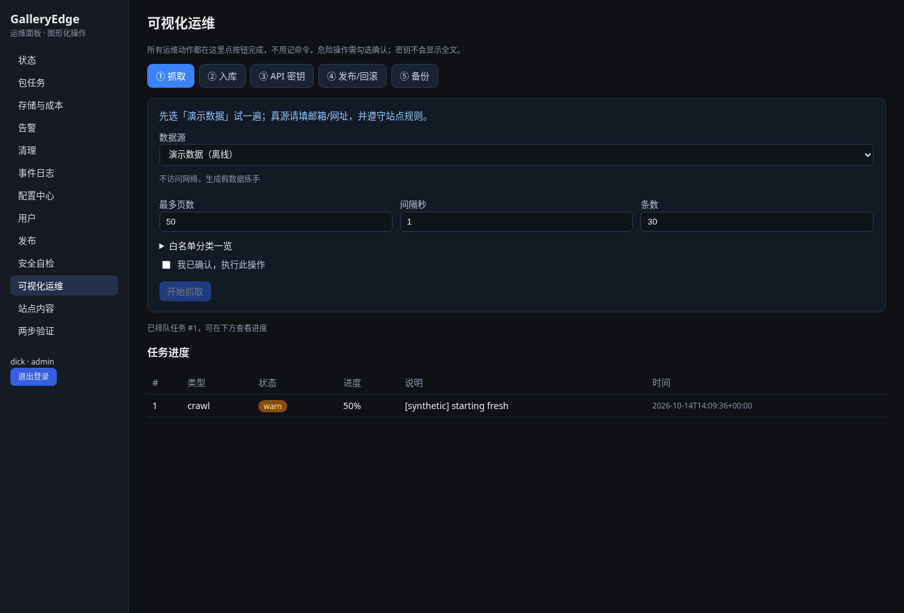

# GalleryEdge · 边缘图阁

[](https://github.com/h1neolzr7f/GalleryEdge/actions/workflows/ci.yml)
[](LICENSE)
[](https://github.com/h1neolzr7f/GalleryEdge/releases)

**中文** | [English](#english)

一个人也能管好的「边缘作品索引 + 图形化运维面板」。

- 把合法、可署名的图片编成可搜索的图库（中文搜索友好）
- 用**本机面板点按钮**完成：安装、抓取、入库、密钥、发布/回滚、备份
- 主库可用本机 SQLite，也可接 Turso（libSQL）；边缘用 Cloudflare Worker 可选

**预览站（staging，自由许可图 + 署名）**  
https://galleryedge-staging.nai-index.workers.dev

---

## 一分钟了解

| 你想… | 怎么做 |
|--------|--------|
| 第一次安装 | 运行安装向导（见下方），浏览器里点几下 |
| 练手、不联网 | 面板 → 可视化运维 → 抓取 → 选「演示数据」 |
| 看真实效果 | 打开上面的 [staging 预览站](https://galleryedge-staging.nai-index.workers.dev) |
| 详细图文 | [小白上手](docs/小白上手.md) |


---

## 合规边界（请先读）

本仓库**故意不做**很多「看起来很方便」的事，避免踩法律与平台红线：

| 可以 | 不可以 |
|------|--------|
| 合成演示数据 | 附带真实作品包、爬取结果、账号 |
| Wikimedia Commons 等**明确允许**且适配器已内置、遵守 robots 的来源 | 随意加「某站真实适配器」PR（见 [CONTRIBUTING](CONTRIBUTING.md)） |
| 只收 CC0 / 公有领域 / CC BY / CC BY-SA 等允许再分发的许可 | 绕过 robots、登录墙、付费墙 |
| 你自己的联系方式进 User-Agent | 账号池、自动注册、共享 Cookie/Token |
| 密钥放本机 0600 文件或加密保险库 | 把 token/密码写进配置、README、截图 |

完整说明：[合规说明](docs/COMPLIANCE.md)。

---

## 安装（推荐：图形向导）

需要：Python 3.10+，本机浏览器。可选 Node.js（用来构建面板前端）。

```bash
git clone https://github.com/h1neolzr7f/GalleryEdge.git
cd GalleryEdge
python -m venv .venv && . .venv/bin/activate   # Windows: .venv\Scripts\activate
pip install -e ".[dev,panel]"
```

**打开安装向导（仅本机）：**

```bash
ge-panel --setup
```

或双击：

- Linux/macOS：`scripts/GalleryEdge-Setup.command`（可先 `chmod +x`）
- Windows：`scripts/GalleryEdge-Setup.bat`

浏览器打开提示的地址（默认 `http://127.0.0.1:8799/`），按步骤创建管理员与保险库口令。装好后用生成的 `config.json` 启动面板：

```bash
ge-panel --config <数据目录>/config.json
```

登录后点左侧 **「可视化运维」**：抓取 → 入库 →（可选）密钥 / 发布 / 备份。  
危险操作都要勾选确认；新 API 密钥只写入本机文件，页面不显示全文。

---

## 预览站与截图

- Staging：https://galleryedge-staging.nai-index.workers.dev  
  Commons 自由许可图，作品页有署名；搜索「中国」「旗」等敏感词应为空（合规过滤）。
- 更多界面图：[docs/screenshots/gui/](docs/screenshots/gui/) · 图文教程：[小白上手](docs/小白上手.md)

| | |
|--|--|
|  |  |
|  |  |

---

## 还能做什么（进阶）

命令行工具仍可用（面板盖不住的场景）：`ge-ops`、`ge-demo`、`ge-crawl`、`ge-ingest`、`ge-keys`、`ge-cf-release`、`ge-db-backup`。  
架构与运维：[docs/ARCHITECTURE.md](docs/ARCHITECTURE.md) · [docs/OPS.md](docs/OPS.md) · [docs/WHITEPAPER.md](docs/WHITEPAPER.md)

```bash
pytest -q          # 跑测试
ge-demo seed && ge-demo serve   # 纯合成演示站 http://127.0.0.1:8787
```

---

## English

**GalleryEdge** is a self-hosted edge work index plus a **local, button-driven ops panel** (health, vault, crawl → ingest, API keys, Cloudflare rollback for `galleryedge-*` only, DB backup). Default data is **synthetic**. Optional Commons adapter: CC0/PD/CC BY/CC BY-SA only, robots honored, attribution shown.

**Staging demo:** https://galleryedge-staging.nai-index.workers.dev

### Compliance

- No bundled real works, presets, or accounts; no account pooling / auto-registration.
- **PRs that add scrapers for arbitrary real sites are not accepted** — see [CONTRIBUTING.md](CONTRIBUTING.md).
- Secrets stay in 0600 files or the encrypted vault — never in config committed to git.

### Setup

```bash
pip install -e ".[dev,panel]"
ge-panel --setup          # localhost wizard
# or double-click scripts/GalleryEdge-Setup.command / .bat
ge-panel --config <data-dir>/config.json
```

Beginner guide (Chinese UI screenshots): [docs/小白上手.md](docs/小白上手.md).

License: [MIT](LICENSE).
