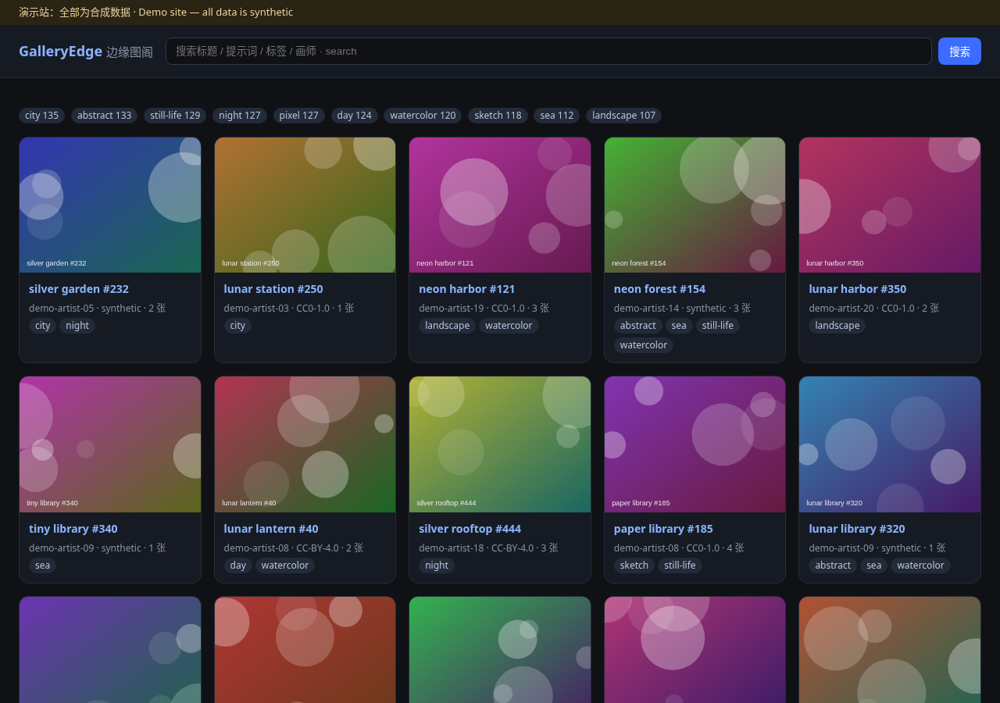
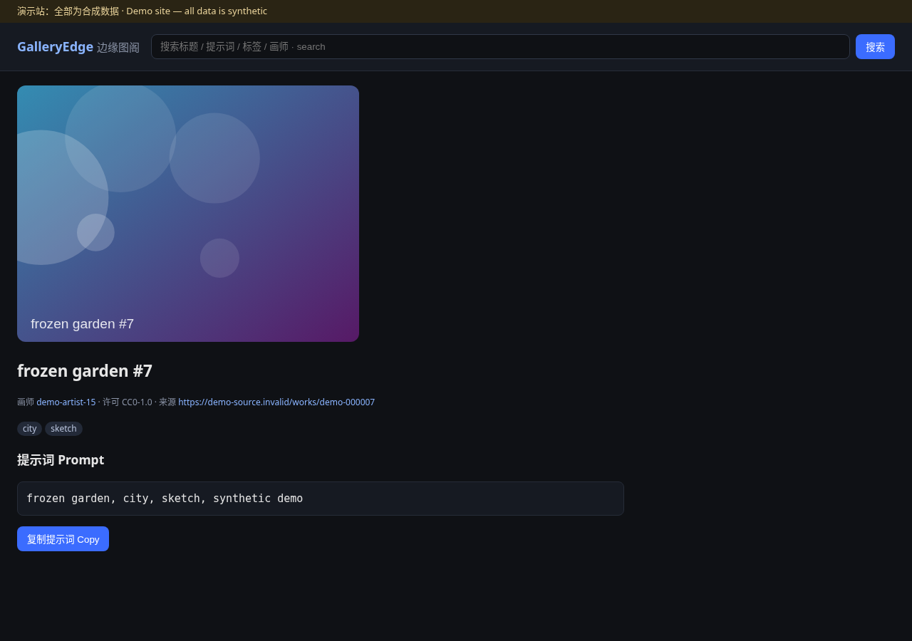
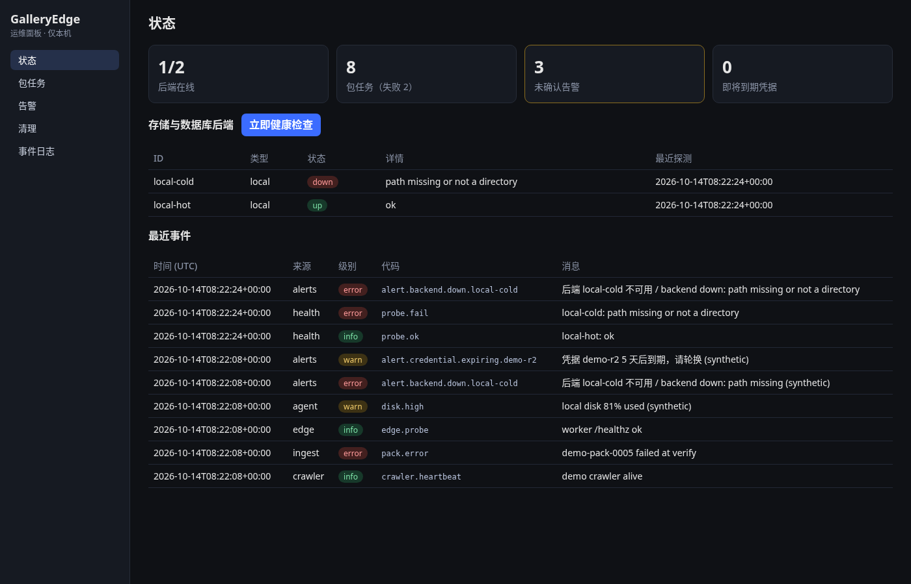
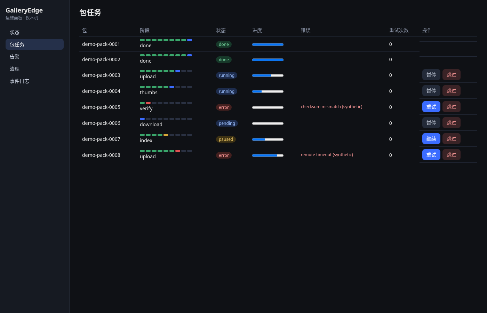
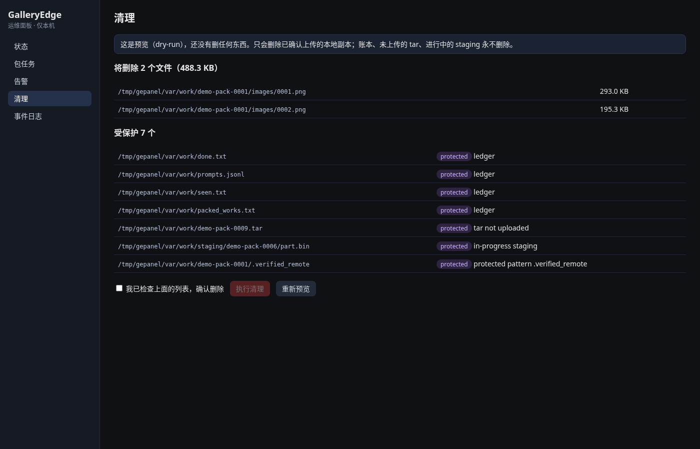
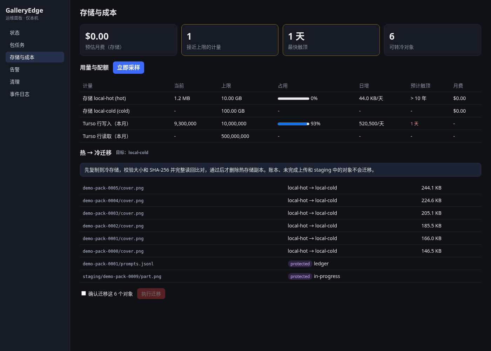
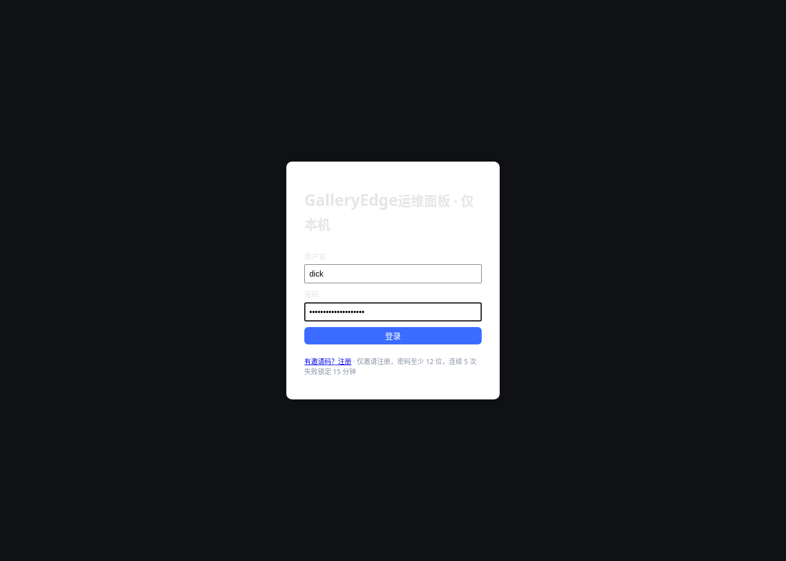
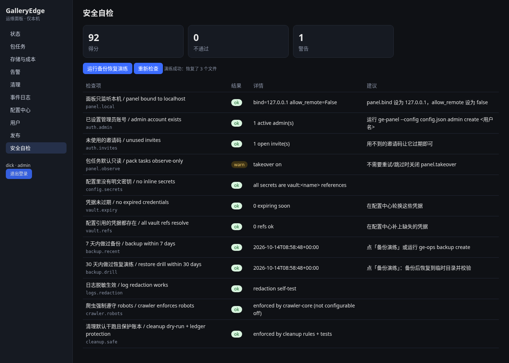

# GalleryEdge · 边缘图阁

[](https://github.com/h1neolzr7f/GalleryEdge/actions/workflows/ci.yml)
License: MIT

**中文** | [English](#english)

给自己用的「边缘作品索引 + 采集入库运维面板」。目标是一个人也能长期管好一套检索系统：健康检查、告警、加密凭据、备份恢复、安全清理、审计、配置中心。主库为 **Turso（libSQL）**，D1 可选。仓库只带**合成数据**，不含任何真实作品或预设，也**不做任何账号自动注册**（见 [合规说明](docs/COMPLIANCE.md)）。

### 当前能做什么（Phase 1）
| 命令 | 作用 |
|---|---|
| `ge-ops config validate config.json` | 配置中心 schema 校验，错误逐项说明 |
| `ge-ops health` | 探测本地目录 / HTTP / libSQL 后端，状态变化触发告警 |
| `ge-ops alerts` | 查看面板内告警；Webhook 推送（可选 HMAC 签名） |
| `ge-ops vault set/get/list/rotate/expiring` | 加密凭据库（AES-GCM + scrypt），轮换、到期提醒、列表只显示掩码 |
| `ge-ops backup create/verify/restore` | 一键备份配置、面板库、加密库，带 SHA-256 清单，恢复到干净目录 |
| `ge-ops cleanup plan/apply` | 只删已确认上传的本地副本；账本、未上传 tar、进行中 staging 永不删；默认 dry-run |
| `ge-ops audit` | 审计日志 |
| `ge-demo-data -n 100` | 生成合成作品数据 |

### 快速开始
```bash
python -m venv .venv && . .venv/bin/activate
pip install -e ".[dev]"
pytest -q
cp examples/config.example.json config.json
export GE_VAULT_PASSPHRASE='choose-a-long-passphrase'
ge-ops --config config.json health
```

### 演示站（Phase 2，约 10 分钟跑通）
```bash
python -m venv .venv && . .venv/bin/activate
pip install -e .
ge-demo seed -n 500            # 生成 500 条合成作品，写入 ./var/demo.db（FTS5 全文检索）
ge-demo serve                  # 打开 http://127.0.0.1:8787
ge-demo key > my.key           # 生成 API Key（只显示一次，库里只存哈希）
curl -H "X-API-Key: $(cat my.key)" "http://127.0.0.1:8787/api/v1/search?q=harbor&tag=night"
```
想走 Turso/libSQL 路径：本机起一个 `sqld --http-listen-addr 127.0.0.1:8080`（或 `docker run -p 8080:8080 ghcr.io/tursodatabase/libsql-server`），再用 `ge-demo --db http://127.0.0.1:8080 seed` / `serve`。真实 Turso 用 `--db libsql://<库>.turso.io`，令牌放环境变量 `GE_LIBSQL_TOKEN`，不要写在命令行里。

页面：作品卡片、标签/画师筛选、全文检索、作品页一键复制提示词。API：`/api/v1/search?q=&tag=&artist=&page=`、`/api/v1/works/<id>`、`/api/v1/tags`，按 Key 计每分钟/每日额度，超额返回 429 + `Retry-After`。




### 运维面板（Phase 3，仅本机）
```bash
pip install -e ".[panel]"
(cd packages/panel/web && npm ci && npm run build)
ge-panel --config config.json --demo   # http://127.0.0.1:8790 ，--demo 写入合成的包任务/告警/事件
```
页面：状态总览（后端、包任务、告警、即将到期凭据、最近事件，一键健康检查）、包任务看板（每包阶段条、失败一键重试、暂停/继续、二次确认跳过）、告警确认、清理（先预览 dry-run，勾选确认后才执行，预览后文件有变化会拒绝执行）、事件日志筛选。默认只读观察：配置 `panel.takeover: true` 才能改包任务。只接受本机连接，写操作需要 `X-GE-Panel` 头防跨站。Cloudflare Worker（TypeScript）在 `packages/edge-worker/worker`。





### 合规采集（Phase 4）：爬取 → 打包 → 入库 → 搜索
```bash
ge-demo-source --port 8788 &                       # 仓库自带的合成演示源站（不碰任何真实网站）
ge-crawl --adapter demo-selfhost --base http://127.0.0.1:8788 --contact you@example.com
ge-ingest --db file:./var/demo.db var/packs/*.tar  # 校验每个包的 SHA-256 和每条记录后再入库
ge-demo serve
```
框架强制：遵守 robots.txt（含 Crawl-delay；robots 不可达则不抓）、按主机限速、诚实 User-Agent（必须填联系方式）、只抓白名单主机、登录墙/付费墙/跳转登录页一律跳过并记录原因、默认只采元数据（`--fetch-media` 才下载媒体）、每条记录带出处和许可（无许可不收）、按 URL 和 id 去重、断点续爬、包带校验。只提供 `demo-selfhost` 和 `synthetic` 两个演示适配器，不提供任何真实站点适配器。包格式见 [docs/PACK_FORMAT.md](docs/PACK_FORMAT.md)。

### 存储路由 / 热冷分层 / 成本（Phase 5）
- `galleryedge_storage`：统一后端接口（本地目录、任何 S3 兼容服务如 R2/MinIO——客户端由你自己构造注入、内存后端；网盘类后端按同一接口接入），按前缀/大小/优先级路由，后端挂了自动切到下一个，写入后校验。
- 热 → 冷迁移：复制 → 校验大小和 SHA-256 → 完整读回比对 → 改索引 → 最后才删热副本；账本、未完成上传、staging 中的对象不迁；默认 dry-run，面板里要勾选确认，预览后计划变化会拒绝执行。
- 计量与成本：定期采样各后端用量和 Turso 行读写（由入库程序上报），线性外推「N 天后触顶」，接近上限或预计 14 天内触顶会告警；按单价估算月费。面板新页面「存储与成本」。



路线图见 [docs/ROADMAP.md](docs/ROADMAP.md)，架构见 [docs/ARCHITECTURE.md](docs/ARCHITECTURE.md)。

---

## English

A **self-use** edge work index plus a one-person ops toolkit: health checks, alerts, encrypted credentials, backup/restore, safe cleanup, audit log and a validated config center. Primary DB is **Turso (libSQL)**; D1 is optional. The repo ships **synthetic data only** and contains **no account auto-registration** of any kind (see [Compliance](docs/COMPLIANCE.md)).

Demo site: `pip install -e . && ge-demo seed && ge-demo serve` → http://127.0.0.1:8787 (synthetic data, FTS5 on SQLite or libSQL/`sqld`/Turso via `--db`). Phase 1 commands are listed in the table above (`ge-ops ...`). Quick start:

```bash
pip install -e ".[dev]" && pytest -q
cp examples/config.example.json config.json
GE_VAULT_PASSPHRASE='...' ge-ops --config config.json health
```

Safety guarantees: the panel binds to `127.0.0.1` by default, secrets are encrypted at rest and masked in all logs, cleanup never touches ledgers (`done.txt`, `seen.txt`, `packed_works.txt`, `prompts.jsonl`), un-uploaded tars or in-progress staging, and CI runs gitleaks on every PR.

## Phase 6 — 登录、账号、配置中心、发布回滚、安全自检 / auth, accounts, config center, releases, self-check

```bash
echo 'your-long-password' | ge-panel --config config.json admin create owner   # 首个管理员 / first admin
GE_VAULT_PASSPHRASE=... ge-panel --config config.json                           # http://127.0.0.1:8790 登录 / log in
ge-panel --config config.json release deploy ./build --version 1.2.0 --migration 3   # 本地模拟发布 / local simulated deploy
ge-panel --config config.json release rollback                                  # 或在面板"发布"页一键回滚
```
新页面：配置中心（端点 + 凭据掩码 + 保险库设置/轮换）、用户（邀请码）、发布、安全自检（含备份恢复演练）。详见 [docs/WHITEPAPER.md](docs/WHITEPAPER.md)。

 

## Phase 7 — 接入现网预发布 / staging integration
aitag 只读桥（`ge-aitag`）、`ge_` 表前缀（`--table-prefix`）、中文 FTS5 搜索、面板只读观察后端（`read_only: true`）、独立 staging Worker（经服务绑定只读代理现网图片）。详见 [docs/STAGING.md](docs/STAGING.md)。
