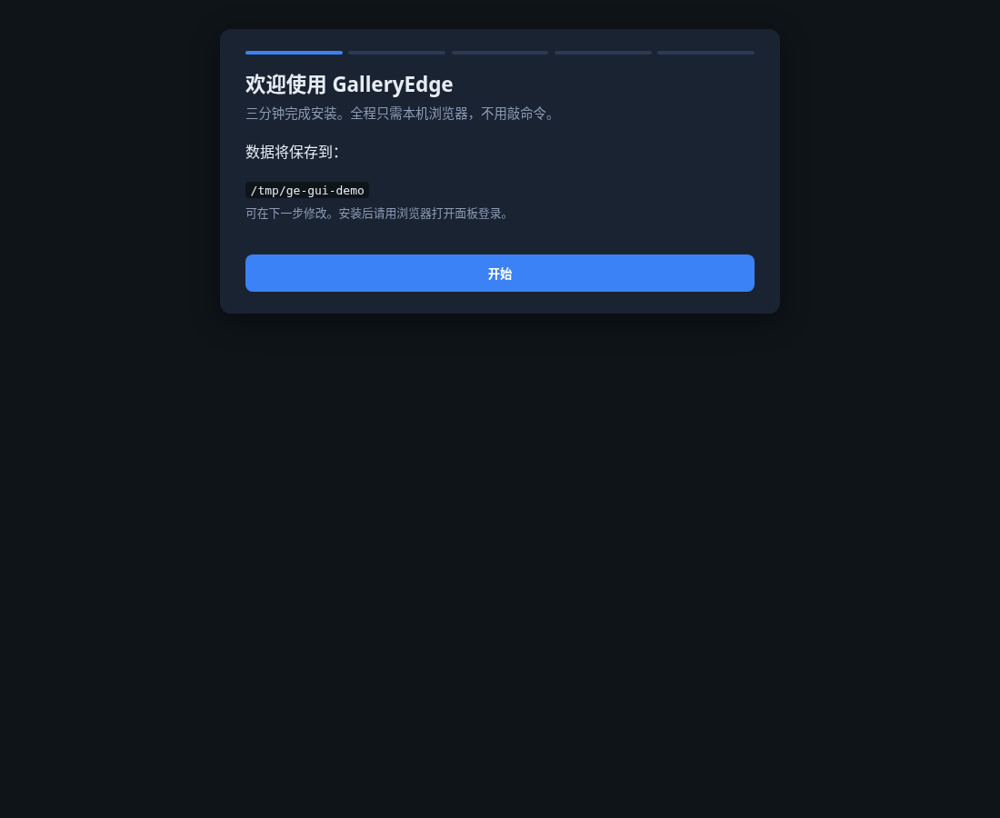
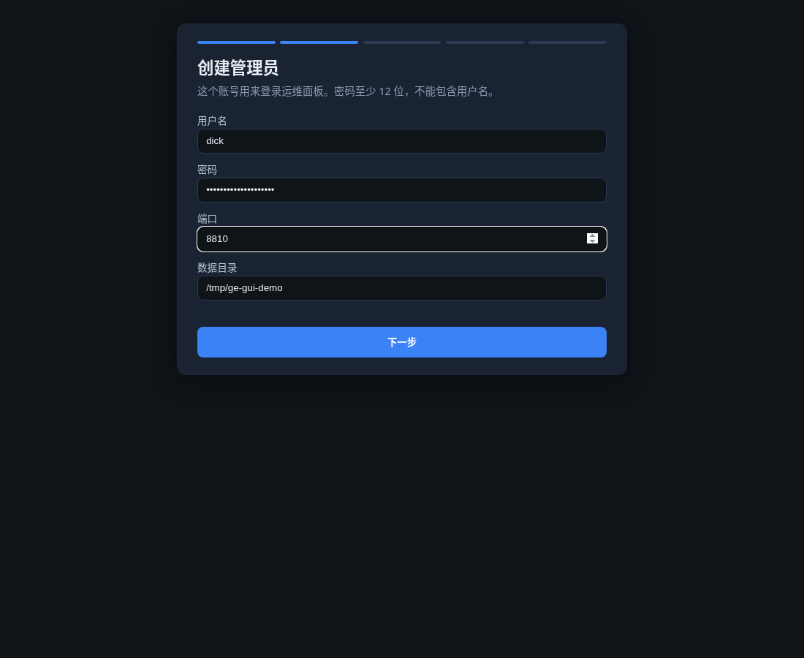
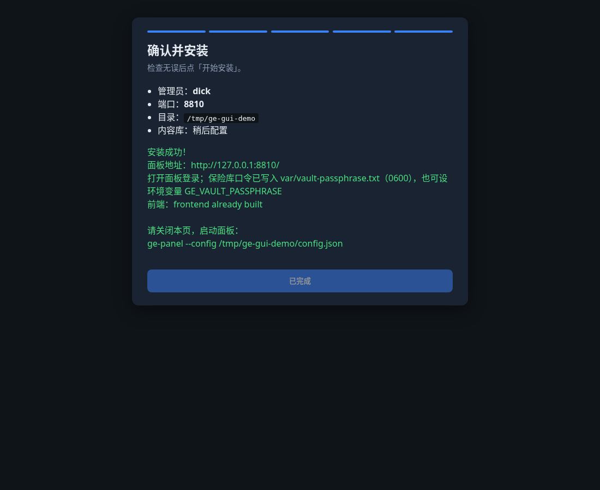
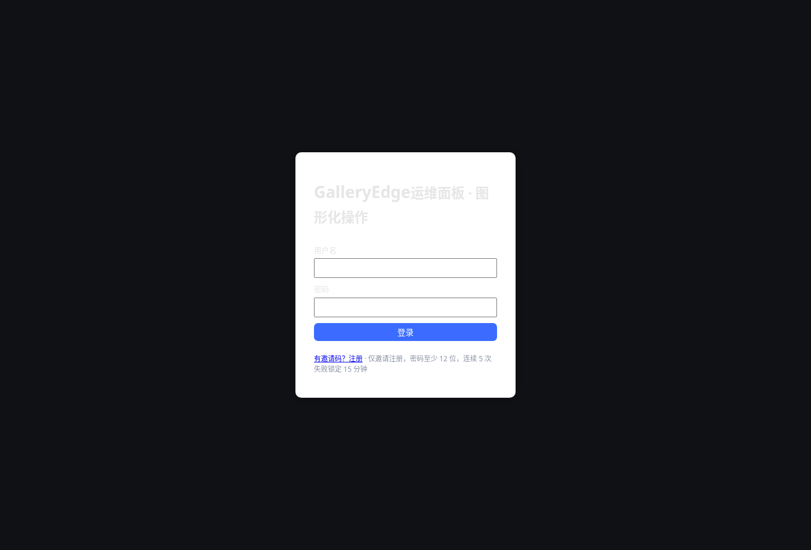
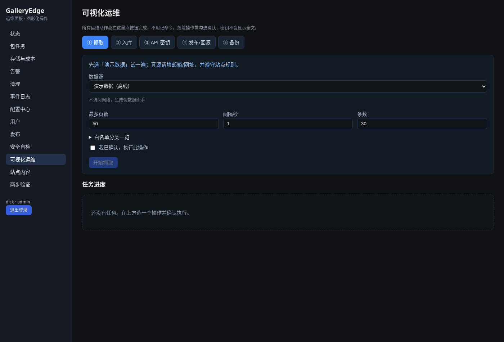
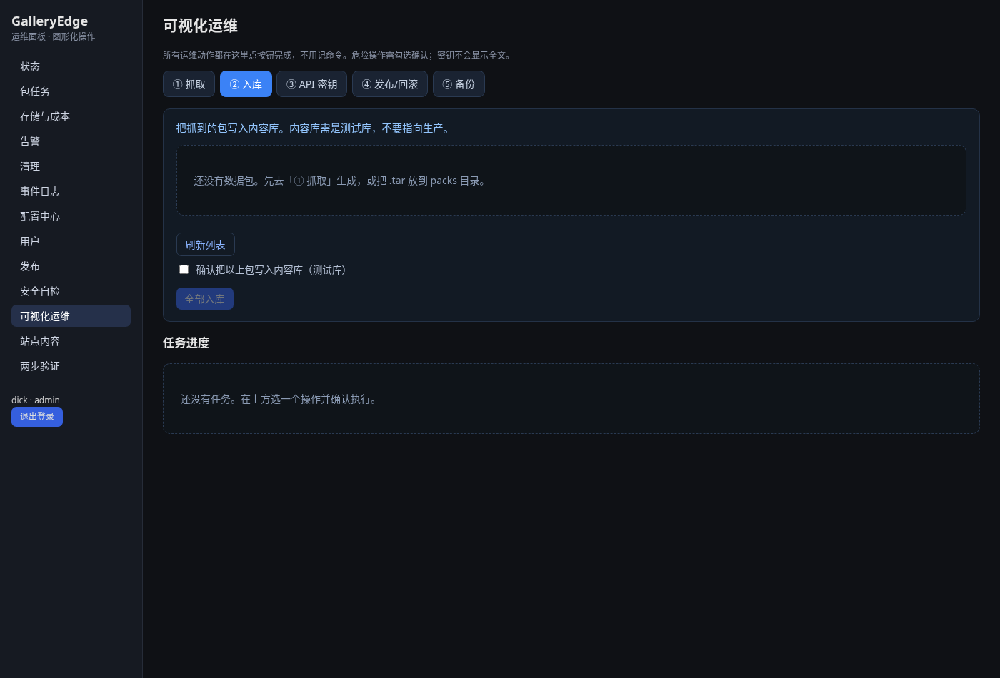
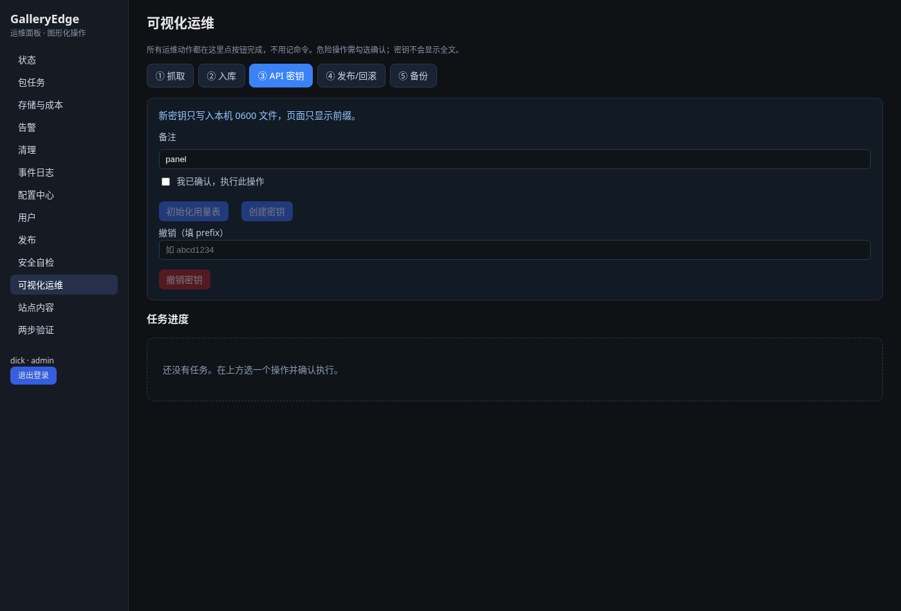
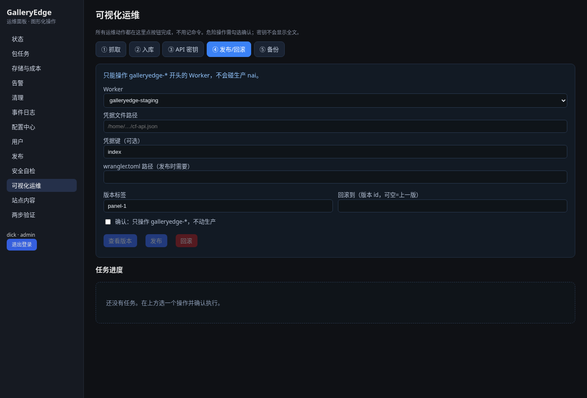
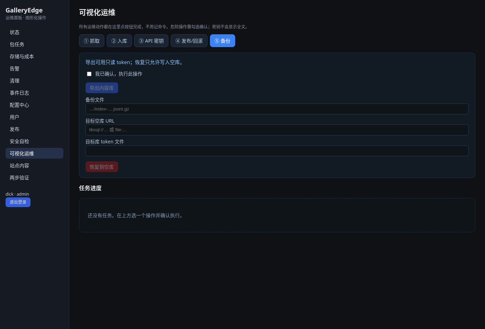

# GalleryEdge 小白上手（全图形化）

> 目标：从零到会抓取、入库、发布，**尽量不碰命令行**。所有密钥只写本机文件，页面不显示全文。

## 一、第一次安装（约 3 分钟）

1. 在项目目录双击或运行安装向导（只会监听本机）：

   若你看到终端，只需这一行：`ge-panel --setup`

2. 浏览器会打开 **首次安装向导**（仅本机可访问）：

3. 按步骤填写：
   - **管理员账号**（密码 ≥ 12 位，不能包含用户名）
   - **保险库口令**（用来加密密钥；会写入本机仅自己可读的文件）
   - **Turso token 文件路径**（可选；没有可跳过，稍后再配。文件权限必须是仅自己可读）

4. 点「开始安装」。成功后记下面板地址，例如 `http://127.0.0.1:8790/`。

5. 用同一方式启动面板（若已写好配置）：`ge-panel --config <数据目录>/config.json`  
   然后用管理员账号登录。

---

## 二、可视化运维（点按钮即可）

登录后，左侧点 **「可视化运维」**。所有动作都要勾选「我已确认」才会执行；进度在下方「任务进度」里刷新。

### ① 抓取

- 新手请先选 **「演示数据（离线）」**，不访问网络。
- 真源（Commons）需填联系邮箱/网址，并遵守站点规则。

### ② 入库

- 把抓到的包写入内容库。
- **只连测试库**，不要指向生产。

### ③ API 密钥

- 「创建密钥」后，密钥写到本机文件（仅自己可读），页面只显示前缀。
- 可按前缀撤销。

### ④ 发布 / 回滚

- 只能操作名字以 `galleryedge-` 开头的 Worker，**不会动生产 nai**。
- 需填写本机 Cloudflare 凭据文件路径（不会显示 token 内容）。

### ⑤ 备份

- 「导出内容库」可用只读 token。
- 「恢复」只允许写到**空库**。

---

## 三、其它常用页面

| 页面 | 做什么 |
|------|--------|
| 站点内容 | 只读浏览/搜索已入库作品 |
| 用户 | 发邀请、改角色、撤销邀请 |
| 两步验证 | 远程登录前请先在本机绑定 |
| 配置中心 | 看端点与凭据掩码；密钥只进保险库 |
| 发布 | 本地版本切换（与 Cloudflare 页不同） |
| 安全自检 | 一键检查常见风险 |

空状态会提示你下一步做什么，例如：

---

## 四、请记住的安全规则

- 面板默认只监听本机；不要对公网裸奔。
- 密钥、token、口令：**文件权限仅自己可读**，页面不显示全文。
- Cloudflare 发布页只允许 `galleryedge-*`，不会替换生产 `nai`。
- 内容库请用测试账号；不要填生产 Turso / R2。

遇到红字报错：看「任务进度」和「事件日志」；仍不懂可把截图发给维护者（打码密钥）。
